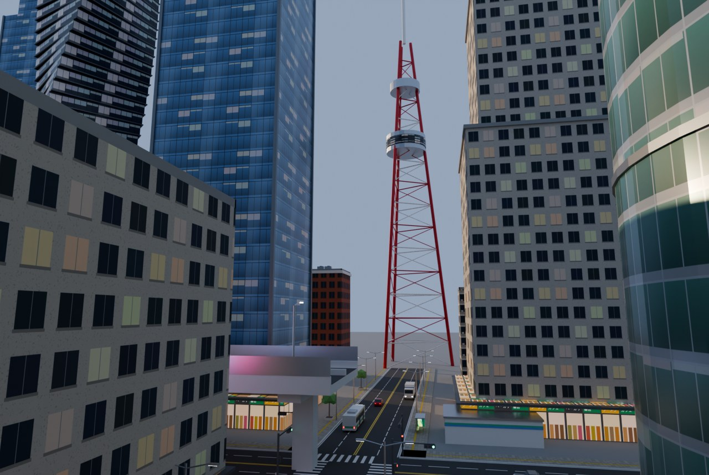

# 大都会3Dモデル集(city-assets)

超高層ビルが並ぶ大都会の街並みを組むためのモデル集です(全44種)。すべて Blender の Python スクリプトで作ったオリジナルで、実在のビルや会社・お店のデザイン、ロゴは使っていません。



- 一覧と3Dプレビュー: `city-assets/index.html`(GitHub Pages なら `https://<ユーザー名>.github.io/godzilla-quiz/city-assets/`)
  - カードを押すとモデルを3Dで回して見られます。「街を組んでみる」で、大通りと交差点のまわりにビルや車を並べた街をその場で組み立てます。
- `demo.jpg` は、モデルを並べてBlenderで描いた夕方のビル街です(`--demo` で作り直せます)。

## 組み立て方

- 大きさは1単位 = 1mの実寸です。Y軸が上、原点は足元の中央、正面は +Z です。
- **道路**: `road_straight` は幅14m(片側2車線)・長さ20m、`road_crossing` は14m四方の交差点です。交差点の中心から17m、37m…の位置に直線をつなぎます。横向きの道は Y軸まわりに90°回します。
- **歩道**: `sidewalk` は幅4m・長さ20mで、縁石が -X 側にあります。車道の中心から9mの位置に、縁石を車道側に向けて置きます。
- **高架**: `highway`(道路)と `rail_viaduct`(鉄道)は長さ40mで、橋脚ごと地面に置きます。40mごとにつなげられます。
- **建物**: そのまま地面に置きます。1階には店舗が並び、屋上には空調設備や航空障害灯があります。屋上に `helipad`・`rooftop_billboard`・`rooftop_hvac` を追加で置けます。
- **大型ビジョン** `big_screen` は壁に付ける物で、原点が壁との接点です。
- 外壁・店先・広告・標識は画像テクスチャ(`textures/`)で、GLBに入っています。外壁の画像は窓4列 × 4階分(12m × 14.4m)で繰り返します。
- 広告画面・店先・街灯・信号・航空障害灯は自分で光ります(emissive)。夜景ではブルームをかけると雰囲気が出ます。

## モデル一覧

| 名前 | ファイル | 分類 | 幅 × 高さ × 奥行 (m) | 三角形 |
|---|---|---|---|---|
| 超高層ビル(青ガラス・150m) | `tower_glass_blue.glb` | 超高層ビル | 41.6 × 169.15 × 41.6 | 452 |
| 超高層ビル(段々の石張り・アールデコ) | `tower_setback.glb` | 超高層ビル | 39.6 × 180.05 × 39.6 | 228 |
| 超高層ビル(円筒形・緑ガラス) | `tower_cylinder.glb` | 超高層ビル | 40.0 × 131.85 × 40.0 | 2148 |
| 超高層ビル(ねじれ・黒ガラス) | `tower_twist.glb` | 超高層ビル | 47.69 × 136.75 × 47.69 | 988 |
| 超高層ビル(ブロンズ・斜めの頂部) | `tower_bronze.glb` | 超高層ビル | 35.6 × 121.35 × 35.6 | 136 |
| オフィスビル(コンクリート・60m) | `office_mid.glb` | 中層ビル | 25.6 × 63.3 × 19.6 | 292 |
| オフィスビル(れんが・36m) | `office_brick.glb` | 中層ビル | 21.6 × 39.1 × 17.6 | 252 |
| タワーマンション(80m) | `apartment_tower.glb` | 中層ビル | 34.0 × 84.3 × 16.0 | 148 |
| マンション(30m) | `apartment_mid.glb` | 中層ビル | 20.0 × 30.8 × 15.5 | 96 |
| 百貨店(大型ビジョン付き) | `dept_store.glb` | 中層ビル | 51.6 × 36.1 × 41.6 | 420 |
| 駅ビル(シティ中央駅) | `station_building.glb` | 中層ビル | 80.2 × 20.1 × 39.1 | 516 |
| 立体駐車場 | `parking_garage.glb` | 中層ビル | 30.12 × 17.0 × 40.91 | 476 |
| 商店建築(3階建て) | `shop_row.glb` | 低層 | 25.6 × 11.3 × 13.97 | 132 |
| コンビニ(ブランドなし) | `konbini.glb` | 低層 | 16.4 × 4.5 × 12.15 | 144 |
| 電波塔(200m) | `broadcast_tower.glb` | タワー・工事 | 28.39 × 201.0 × 32.58 | 2148 |
| タワークレーン | `tower_crane.glb` | タワー・工事 | 66.63 × 72.88 × 3.0 | 1740 |
| 建設中の鉄骨ビル | `construction_frame.glb` | タワー・工事 | 26.0 × 40.36 × 23.35 | 1852 |
| 道路(4車線・20m) | `road_straight.glb` | 道路 | 14.0 × 0.11 × 20.0 | 180 |
| 交差点(横断歩道付き) | `road_crossing.glb` | 道路 | 14.0 × 0.11 × 14.0 | 396 |
| 歩道(4m・縁石つき) | `sidewalk.glb` | 道路 | 4.12 × 0.22 × 20.0 | 24 |
| 高架道路(40m・橋脚つき) | `highway.glb` | 道路 | 20.08 × 23.7 × 40.0 | 356 |
| 鉄道の高架橋(40m) | `rail_viaduct.glb` | 道路 | 11.0 × 17.6 × 40.0 | 1740 |
| 歩道橋(道路をまたぐ) | `ped_bridge.glb` | 道路 | 3.05 × 6.9 × 37.9 | 756 |
| 地下鉄の入口 | `subway_entrance.glb` | 道路 | 3.7 × 6.69 × 7.3 | 276 |
| 信号機(車両・歩行者) | `traffic_light.glb` | 街の小物 | 0.53 × 6.2 × 5.44 | 368 |
| 街灯(LED・二灯) | `street_light.glb` | 街の小物 | 5.9 × 9.16 × 0.35 | 132 |
| 道路案内標識 | `road_sign.glb` | 街の小物 | 4.2 × 6.5 × 5.14 | 68 |
| バス停(ガラスの屋根) | `bus_shelter.glb` | 街の小物 | 5.44 × 3.0 × 1.8 | 188 |
| ベンチ(街) | `bench_city.glb` | 街の小物 | 1.8 × 0.49 × 0.5 | 72 |
| 街路樹(植え込み) | `tree_planter.glb` | 街の小物 | 3.2 × 5.72 × 2.95 | 132 |
| 消火栓 | `fire_hydrant.glb` | 街の小物 | 0.45 × 0.8 × 0.34 | 196 |
| 分別ゴミ箱 | `recycle_bins.glb` | 街の小物 | 1.45 × 1.0 × 0.47 | 72 |
| 自動販売機の列 | `vending_row.glb` | 街の小物 | 3.2 × 1.85 × 0.85 | 108 |
| 車止め | `bollards.glb` | 街の小物 | 4.17 × 0.9 × 0.17 | 440 |
| 大型ビジョン(壁掛け 12m) | `big_screen.glb` | 街の小物 | 12.6 × 7.4 × 0.9 | 24 |
| 屋上の看板 | `rooftop_billboard.glb` | 屋上 | 14.0 × 11.92 × 3.87 | 228 |
| 屋上の空調設備 | `rooftop_hvac.glb` | 屋上 | 9.0 × 2.9 × 5.76 | 572 |
| ヘリポート(屋上) | `helipad.glb` | 屋上 | 22.0 × 0.55 × 22.0 | 948 |
| 乗用車(セダン) | `car_sedan.glb` | 乗り物 | 1.8 × 1.48 × 4.66 | 300 |
| 乗用車(赤・ハッチバック) | `car_red.glb` | 乗り物 | 1.7 × 1.53 × 4.06 | 300 |
| タクシー | `taxi.glb` | 乗り物 | 1.7 × 1.75 × 4.76 | 324 |
| 路線バス | `city_bus.glb` | 乗り物 | 2.57 × 3.3 × 11.09 | 516 |
| トラック(箱型) | `box_truck.glb` | 乗り物 | 2.42 × 3.5 × 7.75 | 444 |
| 通勤電車(1両・20m) | `commuter_train.glb` | 乗り物 | 2.96 × 5.23 × 20.08 | 740 |

`models.json` にも同じ情報(と使っているマテリアル、ファイルサイズ)が入っています。

## 作り直す・追加する

```
pip install bpy pillow
python3 tools/make_textures.py             # 外壁・店先・道路・広告・標識の画像
python3 tools/make_models.py --render      # 全モデル(glb/、preview/、models.json、tools/city.blend)
python3 tools/make_models.py --render --demo   # さらに組み立て例 demo.jpg を描く(CPUで数分)
python3 tools/write_readme.py              # このREADMEのモデル一覧を更新
```

- 部品を作る関数(箱・円柱・テクスチャ付きの箱など)は、城砦街モデル集(`../kowloon-assets/tools/make_models.py`)と田舎モデル集(`../inaka-assets/tools/make_models.py`)のものを共通で使っています。
- モデルを追加するときは、`tools/make_models.py` に `@K.model('名前', '日本語名', '分類')` をつけた関数を書きます。ビルの外壁は `facade('glass_blue', サイズ, 位置)` で貼れます。
- 広告や看板の言葉は、架空のもの(「新発売」「SALE」「シティ中央駅」など)だけです。
