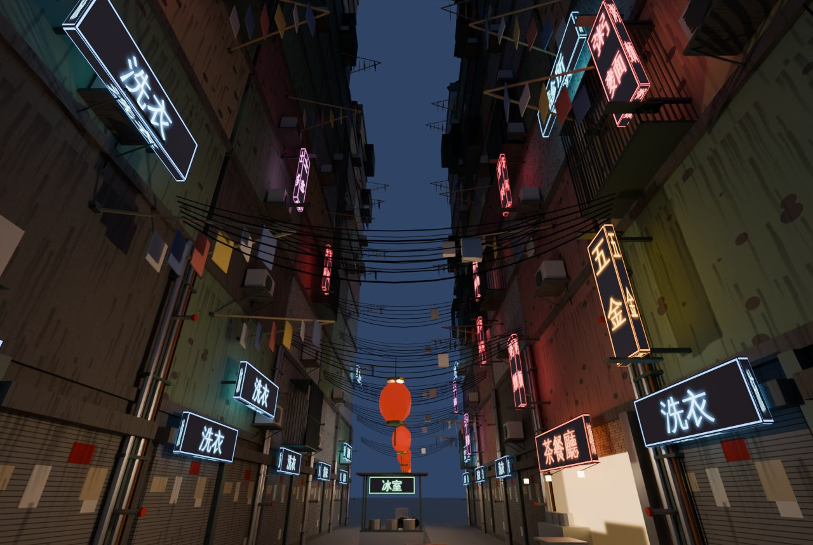

# 城砦街3Dモデル集(kowloon-assets)

九龍城砦のような、建て増しを重ねた高層の密集街を組むためのモデル集です(全48種)。すべて Blender の Python スクリプトで作ったオリジナルです。



- 一覧と3Dプレビュー: `kowloon-assets/index.html`(GitHub Pages なら `https://<ユーザー名>.github.io/godzilla-quiz/kowloon-assets/`)
  - カードを押すとモデルを3Dで回して見られます。「街区に組んでみる」で、階ユニットを積んだ街区をその場で組み立てて表示します。
- `demo.jpg` は、モデルを路地沿いに積み上げてBlenderで描いた夜の路地です(`--demo` で作り直せます)。

## 組み立て方

| 種類 | 原点 | 使い方 |
|---|---|---|
| 階ユニット(`floor_*`) | 床の中心 | 1階分が高さ3m。y = 0, 3, 6 … と積み上げます。1階には店舗(`floor_shop_*`)、最上階の上には `roof_parapet` を置きます。向きを180°変えたり、色違いを混ぜると建て増し感が出ます。 |
| 壁に付ける物(看板・室外機・檻・配管・洗濯竿・ひさし など) | 壁との接点(下端中央) | 壁の面に置くと、正面(+Z)へ張り出します。建物の壁は中心から3m(幅4mのユニットは2m)のところです。 |
| 屋上の物 | 足元の中央 | 屋上(各棟の最上階の高さ + 0.2m)に置きます。 |
| 吊り下げる物(電線・電球・提灯) | 吊り下げる点 | 電線の束は両端の高さが原点で、そこから下にたるみます。 |
| 路地の物 | 足元の中央 | そのまま地面に置きます。 |

- 大きさは1単位 = 1mの実寸です。Y軸が上、正面は +Z です。
- 壁・トタン・シャッター・タイル・看板は画像テクスチャ(`textures/`)で汚れや雨だれ、漢字を描いています。テクスチャはGLBに入っているので、ファイル1つで使えます。
- 看板と明かりのついた窓は自分で光ります(emissive)。夜の場面でブルーム(光のにじみ)をかけると雰囲気が出ます。
- 階ユニットの窓は、作るときにいくつかを「明かりのついた窓」にしています。

## モデル一覧

| 名前 | ファイル | 分類 | 幅 × 高さ × 奥行 (m) | 三角形 |
|---|---|---|---|---|
| 階ユニット(緑の塗装) | `floor_green.glb` | 階ユニット | 6.16 × 3.0 × 7.14 | 984 |
| 階ユニット(ピンク・鉄格子ベランダ) | `floor_pink.glb` | 階ユニット | 6.16 × 3.0 × 7.54 | 1880 |
| 階ユニット(モザイクタイル) | `floor_tile.glb` | 階ユニット | 6.16 × 3.0 × 6.73 | 632 |
| 階ユニット(クリーム・増築の張り出し) | `floor_cream.glb` | 階ユニット | 6.16 × 3.81 × 8.07 | 836 |
| 階ユニット(青・幅4m) | `floor_blue_narrow.glb` | 階ユニット | 4.16 × 3.0 × 6.7 | 488 |
| 階ユニット(打ちっぱなし・小窓) | `floor_concrete.glb` | 階ユニット | 6.16 × 3.0 × 6.31 | 1464 |
| 店舗の階(シャッター) | `floor_shop_shutter.glb` | 階ユニット | 6.16 × 3.05 × 6.67 | 156 |
| 店舗の階(営業中の食堂) | `floor_shop_open.glb` | 階ユニット | 6.16 × 3.15 × 7.83 | 528 |
| 屋上(手すり壁) | `roof_parapet.glb` | 階ユニット | 6.16 × 1.2 × 6.16 | 180 |
| エアコン室外機 | `ac_unit.glb` | 壁に付ける物 | 0.95 × 1.21 × 0.66 | 252 |
| 窓用エアコン | `ac_window.glb` | 壁に付ける物 | 0.64 × 0.46 × 0.46 | 84 |
| 鉄格子の檻(ベランダ) | `cage_balcony.glb` | 壁に付ける物 | 2.3 × 2.24 × 0.85 | 588 |
| 物干し竿(張り出し) | `laundry_pole.glb` | 壁に付ける物 | 1.72 × 0.71 × 2.64 | 136 |
| 縦看板「牙科」 | `sign_0.glb` | 看板 | 0.7 × 2.17 × 1.23 | 60 |
| 横看板「診所」 | `sign_1.glb` | 看板 | 2.6 × 0.86 × 0.62 | 36 |
| 縦看板「麵家」 | `sign_2.glb` | 看板 | 0.7 × 2.17 × 1.23 | 60 |
| 横看板「冰室」 | `sign_3.glb` | 看板 | 2.6 × 0.86 × 0.62 | 36 |
| 縦看板「士多」 | `sign_4.glb` | 看板 | 0.7 × 2.17 × 1.23 | 60 |
| 横看板「理髮」 | `sign_5.glb` | 看板 | 2.6 × 0.86 × 0.62 | 36 |
| 縦看板「五金」 | `sign_6.glb` | 看板 | 0.7 × 2.17 × 1.23 | 60 |
| 横看板「洗衣」 | `sign_7.glb` | 看板 | 2.6 × 0.86 × 0.62 | 36 |
| 縦看板「粥麵」 | `sign_8.glb` | 看板 | 0.7 × 2.17 × 1.23 | 60 |
| 横看板「跌打」 | `sign_9.glb` | 看板 | 2.6 × 0.86 × 0.62 | 36 |
| 配管の束(3m・縦につなげる) | `pipe_bundle.glb` | 壁に付ける物 | 0.7 × 3.0 × 0.57 | 260 |
| 雨どいの縦管(3m) | `downpipe.glb` | 壁に付ける物 | 0.14 × 3.0 × 0.16 | 60 |
| トタンのひさし | `awning_tin.glb` | 壁に付ける物 | 2.4 × 0.7 × 1.18 | 52 |
| 電気メーター盤 | `elec_meters.glb` | 壁に付ける物 | 1.36 × 1.8 × 0.2 | 468 |
| 集合ポスト | `letterboxes.glb` | 壁に付ける物 | 1.45 × 1.14 × 0.34 | 24 |
| 壁の祠(土地神) | `wall_shrine.glb` | 壁に付ける物 | 0.6 × 0.64 × 0.3 | 176 |
| 裸の蛍光灯 | `fluoro_tube.glb` | 壁に付ける物 | 1.25 × 0.06 × 0.1 | 48 |
| 鉄の扉 | `iron_gate.glb` | 壁に付ける物 | 1.0 × 2.3 × 0.12 | 156 |
| 給水タンク(ステンレス) | `water_tank_steel.glb` | 屋上 | 1.82 × 2.92 × 1.56 | 328 |
| 給水タンク(青い樹脂) | `water_tank_plastic.glb` | 屋上 | 1.3 × 1.8 × 1.3 | 212 |
| 屋上の小屋(トタン) | `roof_shack.glb` | 屋上 | 3.3 × 2.66 × 2.8 | 164 |
| テレビアンテナ群 | `antennas.glb` | 屋上 | 3.51 × 5.2 × 3.39 | 1772 |
| 衛星アンテナ | `satellite_dish.glb` | 屋上 | 0.86 × 1.61 × 0.67 | 128 |
| 狭い階段(1階分) | `stairs_narrow.glb` | 路地 | 1.24 × 3.91 × 4.02 | 432 |
| 路地の床(6m・排水溝つき) | `alley_floor.glb` | 路地 | 2.0 × 0.07 × 6.0 | 404 |
| 渡り廊下(建物の間・4m) | `catwalk.glb` | 路地 | 1.25 × 3.0 × 4.03 | 292 |
| 電線の束(6m・たるみ付き) | `cable_span.glb` | 路地 | 6.01 × 1.22 × 0.32 | 1164 |
| 屋台(裸電球つき) | `hawker_stall.glb` | 路地 | 2.37 × 2.24 × 1.2 | 364 |
| プラスチック椅子の山 | `stool_stack.glb` | 路地 | 1.18 × 0.52 × 0.62 | 388 |
| プラスチックケースの山 | `crates.glb` | 路地 | 1.05 × 0.94 × 0.37 | 240 |
| 発泡スチロール箱 | `foam_boxes.glb` | 路地 | 1.27 × 1.12 × 0.48 | 72 |
| ゴミ袋の山 | `trash_bags.glb` | 路地 | 1.55 × 0.82 × 1.79 | 572 |
| プロパンガスのボンベ | `gas_cylinders.glb` | 路地 | 1.04 × 0.92 × 0.32 | 504 |
| 裸電球(吊り下げ) | `bare_bulb.glb` | 路地 | 0.1 × 0.95 × 0.1 | 128 |
| 赤い提灯 | `lantern_red.glb` | 路地 | 0.42 × 1.15 × 0.44 | 208 |

`models.json` にも同じ情報(と使っているマテリアル、ファイルサイズ)が入っています。

## 作り直す・追加する

```
pip install bpy pillow
python3 tools/make_textures.py             # 汚れた壁・トタン・シャッター・タイル・看板(繁体字)の画像
python3 tools/make_models.py --render      # 全モデル(glb/、preview/、models.json、tools/kowloon.blend)
python3 tools/make_models.py --render --demo   # さらに組み立て例 demo.jpg を描く(CPUで数分)
python3 tools/make_models.py --hi --render # ハイポリ版(glb_hi/ などに出力)
```

- 箱や円柱などの基本の部品と、ハイポリ化の処理は、田舎モデル集の `../inaka-assets/tools/make_models.py` を共通で使っています。
- モデルを追加するときは、`tools/make_models.py` に `@K.model('名前', '日本語名', '分類')` をつけた関数を書きます。テクスチャを貼る箱は `tbox('テクスチャ名', サイズ, 位置)`、窓は `window(...)` で作れます。
- 看板の文字はWenQuanYi Zen Hei(繁体字対応のフォント)で描いています。店名は一般的な言葉(牙科・麵家・冰室など)だけです。
