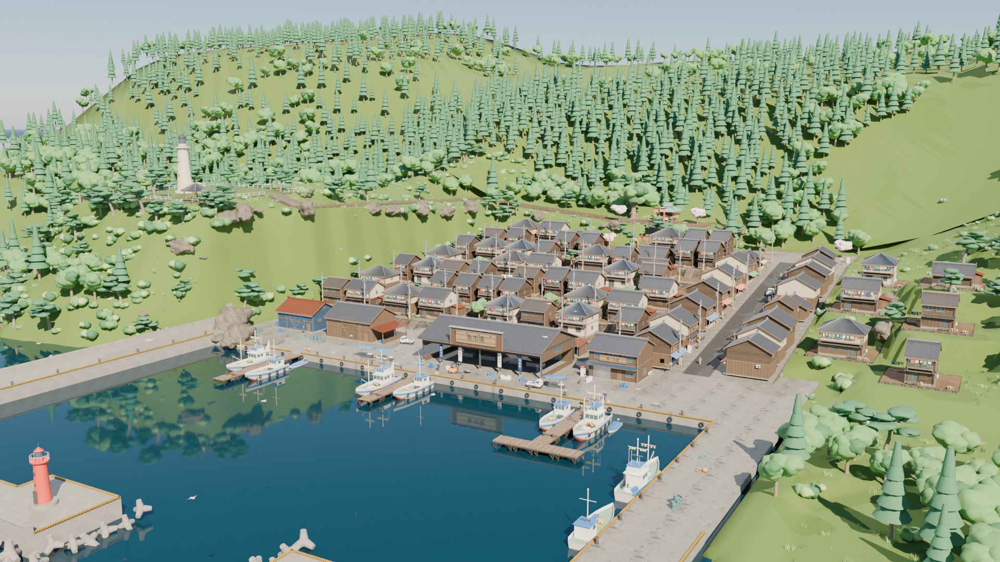
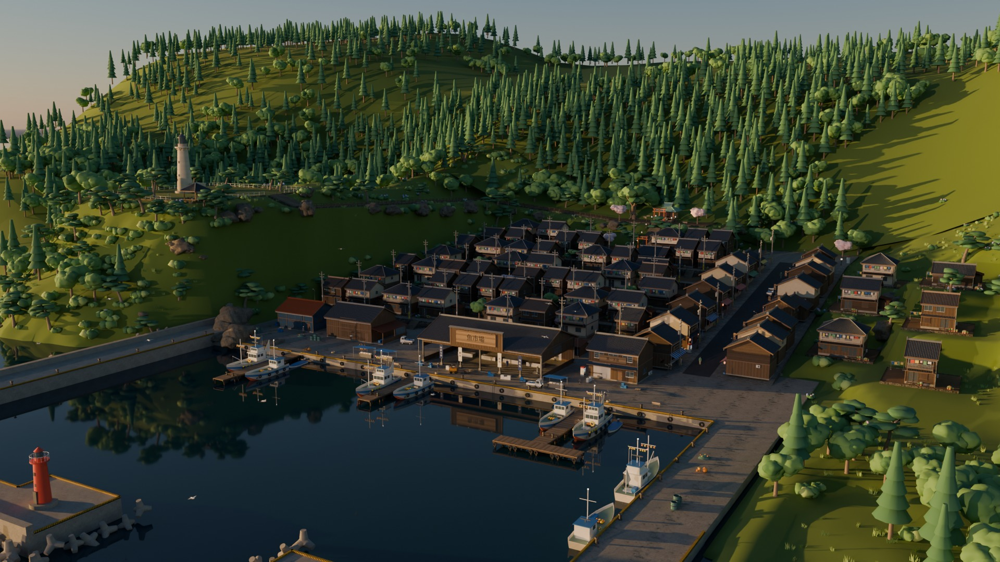
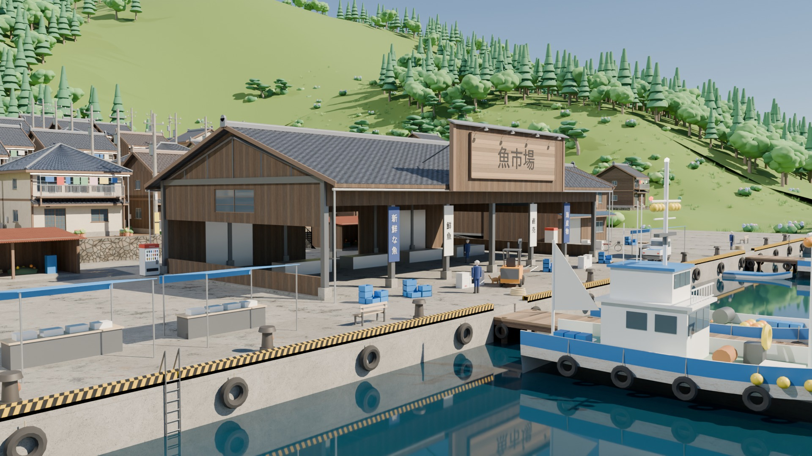
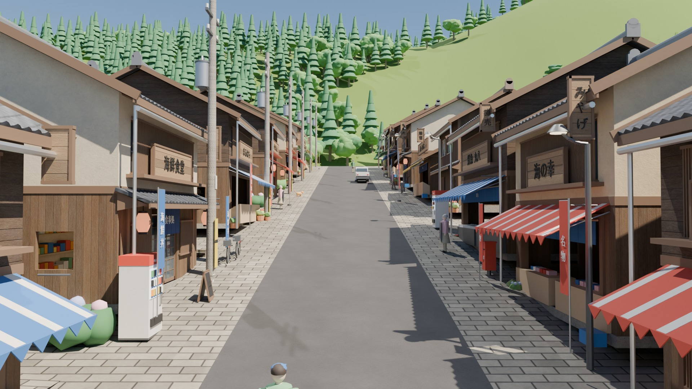
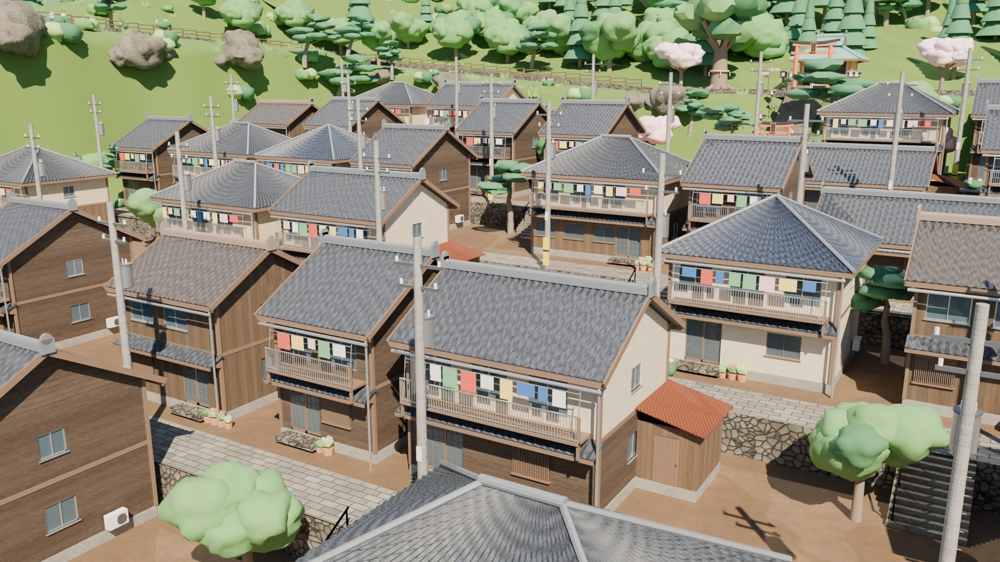
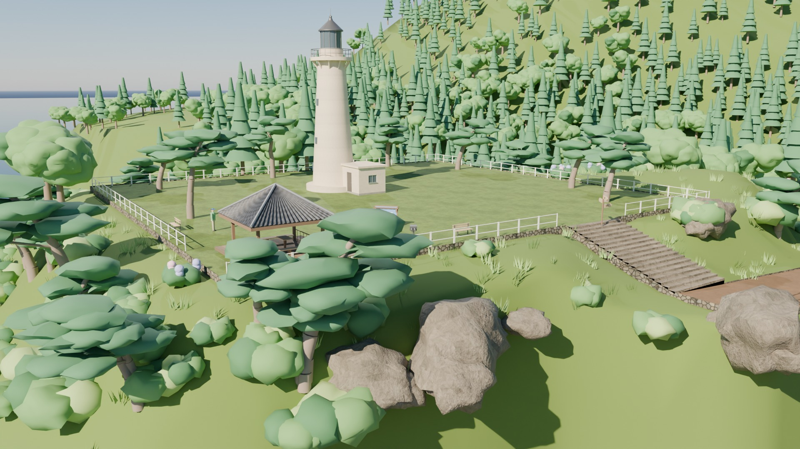

# 海凪の港町 3Dモデル集(uminagi-assets)

日本の地方の漁港の町「海凪の港町」を組み立てるためのモデル集です。すべて Blender の Python スクリプト(`tools/make_models.py`)で作ったオリジナルのモデルで、これを使った探索ゲームが `../uminagi/` にあります。

- 一覧と3Dプレビュー: `uminagi-assets/index.html`(GitHub Pages なら `https://<ユーザー名>.github.io/godzilla-quiz/uminagi-assets/`)
- 町全体: `scene/`(ゲームから書き出した配置データと地面、Blenderで組み直した町。下の「町全体のシーンデータ」)

## 作り方(画像を貼った箱ではなく、実際の立体)

- **壁**は窓・戸の位置に本当に穴が開いていて、穴の側面(見込み)まであります。窓は枠・桟・ガラスが穴の中に入り、奥に障子やカーテンを置いているので、斜めから見ても中がのぞけてしまうことがありません。格子窓(木の縦格子)、引き違いの格子戸、倉庫の大きな引き戸(上レール・筋交い付き)、シャッターも部品として作っています。
- **屋根**は瓦の波形を実際の凹凸で作った屋根板に、棟瓦・鬼瓦・破風板・鼻隠し・垂木の先、雨どいと縦どいを付けています。切妻・寄棟・庇(ひさし)・片流れの4種類。
- **看板の文字**(魚市場、第一水産、海鮮食堂、のれんの「食事処」、のぼり旗、船名の「海凪丸」など)は、日本語フォントから作った厚みのある3D文字です。
- **漁船**は断面(キール・チャイン・舷側のフレア・ブルワーク)を船首から船尾までつないで作った船体に、操舵室、マスト、レーダー、アンテナ、航海灯、ブーム、帆、ネットホーラー、ウインチ、魚倉ハッチ、防舷タイヤ、浮き、そして水面下の舵とプロペラまで付いています。
- 木目・瓦の重なり・石垣の目地・錆・コンクリートの染みのように、凹凸にするほどではない細かい表情は、タイル状のPBRテクスチャ(色+法線マップ、魚市場まわりの濡れた地面は粗さマップも)で出しています(`tools/make_textures.py` が numpy で作る、継ぎ目なしの512px画像)。

## 決まりごと

- 形式: glTF バイナリ(`glb/*.glb`)。**EXT_meshopt_compression と KHR_mesh_quantization で圧縮しています**(three.js なら `GLTFLoader.setMeshoptDecoder(MeshoptDecoder)` で読めます。Blender の取り込みは meshopt 非対応のビルドがあるので、Blender で編集するときは `make_models.py` から作り直すか、`tools/optimize.sh` をかける前の書き出しを使ってください)。
- 大きさ: **1単位 = 1m** の実寸。Y軸が上、正面は +Z、原点は足元の中央(船は喫水線の中央)。
- 各GLBには `<名前>_body`(通常)と `<名前>_lod1`(約30%に減らした遠景用)の2つのメッシュが入っています(動く部品があるモデルは LOD1 なし)。
- **UVはメートル単位**(各面の水平方向が u、面に沿った上方向が v)。GLBには画像を入れず、マテリアル名だけを入れています。`materials.json` がマテリアル名 → 色・粗さ・金属度・テクスチャ名・発光の対応表で、`textures/textures.json` がテクスチャ1枚が覆う実寸(m)です。three.js では `texture.repeat = 1 / size_m` にして名前で貼り替えます(ゲームの `../uminagi/js/materials.js` が実例)。同じ名前のマテリアルは全モデルで共有できます。
- 光るもの(夜に明るくする): `lamp`(電灯)、`lantern_red` / `lantern_white`(提灯・灯籠)、`vend_panel`(自販機)、`beacon_red` / `beacon_white`(灯台)、`window_lit`(明かりのついた窓)。
- 動かす部品は別ノードで、原点が軸の位置にあります: 灯台の光 `lighthouse_lamp`、赤灯台の光 `lighthouse_red_lamp`、漁船のレーダー `fishing_boat_radar` とプロペラ `fishing_boat_prop`、人物の手足 `<名前>_arm_l/r`・`<名前>_leg_l/r`(肩・股関節が原点)、カモメの翼 `seagull_wing_l/r`、猫のしっぽ `cat_tail`。
- 共通部品(壁・窓・戸・屋根・庇・手すり・提灯・のれん・看板・植木鉢など)は `make_models.py` の関数で、建物はその組み合わせです。住宅は `house()`、商店は `shop()` の引数(幅・奥行・階数・壁材・屋根形・看板の文字・のれん・日よけの色・品物)を変えるだけで別のバリエーションが作れます。

## 作り直し方

```
pip install bpy numpy pillow                 # bpy = Blender 5.x の Python モジュール
python3 tools/make_textures.py               # textures/
python3 tools/make_models.py [--render] [名前...]   # glb/ models.json materials.json tools/uminagi.blend (--render で preview/)
npm i -g @gltf-transform/cli@4 && sh tools/optimize.sh   # glb/ を meshopt 圧縮
python3 tools/write_readme.py                # この表を models.json から更新
```

`tools/uminagi.blend` は全モデルを1ファイルにまとめた Blender データです(モデルごとにコレクション、テクスチャ付きマテリアル)。

## 町全体のシーンデータ(`scene/`)

| ファイル | 中身 |
|---|---|
| `placements.json` | ゲームが組み立てた町の全配置(モデル名・位置・回転・拡大率・壁の色味)とエリアの範囲。ゲームの `tools/export_scene.mjs` で書き出し |
| `ground.glb` | ゲームが生成する地面: 自然の地形(海底を含む)、港の岸壁・防波堤・桟橋、商店街の坂道、7段の住宅の段々と石垣、石段・手すり、神社の境内、崖の遊歩道、灯台の丘 |
| `uminagi_town.glb` | 同じ町を1つのGLBにしたもの(EXT_mesh_gpu_instancing でモデルを使い回し、meshopt 圧縮。テクスチャは入っていないので `materials.json` で貼り替え) |
| `uminagi_town.blend` | 上の2つから `tools/assemble_town.py` で組み直した町全体(モデルはリンクしたコレクションインスタンスなので、元モデルを直すと町全体に反映) |

## 町全体の高品質レンダリング(Cycles)

`tools/render_town.py` は `scene/uminagi_town.blend` を Blender の Cycles(パストレーシング、物理ベースの空、デノイズ)で描き、`scene/render_<視点>.jpg` を書き出します。視点は全景・漁港・商店街・住宅の段々・灯台の丘・夕方の全景の6つです。

```
python3 tools/render_town.py [--samples 96] [--size 1920x1080] [overview harbour street terraces hill evening]
```

| | |
|---|---|
|  |  |
|  |  |
|  |  |

テクスチャは `python3 tools/make_textures.py --1k` で1024px版(`textures/1k/`、ゲームの「最高(PC)」用)も作れます。

## モデル一覧

<!-- MODELS -->
| 名前 | ファイル | 分類 | 幅 × 高さ × 奥行 (m) | 三角形 (LOD0 / LOD1) | 部品ノード |
|---|---|---|---|---|---|
| 細長い家(R1) | `house_narrow.glb` | 住宅 | 6.59 × 8.5 × 9.18 | 7434 / 1971 | — |
| 標準的な家(R2) | `house_standard.glb` | 住宅 | 11.63 × 8.38 × 8.66 | 11172 / 3112 | — |
| 二階建ての家(R3) | `house_twostory.glb` | 住宅 | 10.71 × 8.41 × 9.0 | 11223 / 3132 | — |
| 平屋(R5) | `house_hira.glb` | 住宅 | 11.8 × 5.8 × 8.72 | 11574 / 3266 | — |
| 古い木造の家(R6) | `house_old.glb` | 住宅 | 7.75 × 8.17 × 7.65 | 9379 / 2577 | — |
| 寄棟の家(R7) | `house_hipped.glb` | 住宅 | 8.89 × 8.27 × 9.27 | 10840 / 2937 | — |
| 高台の家(R4・石垣付き) | `house_hillside.glb` | 住宅 | 10.41 × 10.9 × 9.54 | 11366 / 3046 | — |
| 雑貨店 まるはち(S1) | `shop_general.glb` | 商店 | 8.28 × 8.97 × 11.01 | 11960 / 3394 | — |
| 海鮮食堂(S2) | `shop_restaurant.glb` | 商店 | 8.99 × 8.83 × 11.9 | 15864 / 4479 | — |
| 居酒屋 やまもと(S3) | `shop_izakaya.glb` | 商店 | 7.68 × 8.92 × 12.02 | 13756 / 3941 | — |
| お土産 海の幸(S4) | `shop_souvenir.glb` | 商店 | 8.76 × 9.18 × 11.63 | 14492 / 4143 | — |
| 鮮魚店(S5) | `shop_fish.glb` | 商店 | 9.13 × 9.1 × 11.22 | 9980 / 2672 | — |
| 喫茶 しおかぜ(S6・角の店) | `shop_cafe.glb` | 商店 | 8.39 × 8.98 × 10.67 | 10766 / 2964 | — |
| 酒屋(S7・平屋) | `shop_sake.glb` | 商店 | 7.68 × 6.03 × 9.9 | 12648 / 3642 | — |
| 魚市場 | `fish_market.glb` | 漁港 | 31.55 × 10.34 × 20.23 | 20620 / 5925 | — |
| 水産会社の事務所兼倉庫(第一水産) | `suisan_office.glb` | 漁港 | 12.56 × 9.24 × 11.09 | 8672 / 2437 | — |
| 漁業倉庫(木造) | `warehouse_wood.glb` | 漁港 | 18.43 × 8.93 × 11.56 | 8620 / 2408 | — |
| 漁業倉庫(トタン) | `warehouse_tin.glb` | 漁港 | 13.0 × 8.24 × 10.53 | 3854 / 1012 | — |
| 漁具置き場(片流れの小屋) | `gear_shed.glb` | 漁港 | 8.6 × 3.1 × 5.2 | 3468 / 1014 | — |
| 灯台(白・高台) | `lighthouse.glb` | 灯台・展望台 | 8.93 × 18.9 × 6.43 | 4642 / — | lighthouse_lamp |
| 赤灯台(防波堤) | `lighthouse_red.glb` | 灯台・展望台 | 3.7 × 9.0 × 3.7 | 2804 / — | lighthouse_red_lamp |
| 鳥居(朱) | `torii.glb` | 神社 | 5.33 × 5.46 × 0.68 | 2148 / 640 | — |
| 社殿(小さな拝殿) | `shrine_hall.glb` | 神社 | 8.01 × 6.53 × 7.65 | 5310 / 1496 | — |
| 賽銭箱 | `saisen_box.glb` | 神社 | 1.3 × 0.78 × 0.7 | 1408 / 419 | — |
| 石灯籠 | `ishidoro.glb` | 神社 | 1.26 × 2.48 × 1.1 | 1352 / 396 | — |
| 狛犬 | `komainu.glb` | 神社 | 0.87 × 1.94 × 1.06 | 2986 / 884 | — |
| 展望台の東屋(四阿) | `azumaya.glb` | 灯台・展望台 | 6.4 × 4.76 × 6.4 | 3354 / 964 | — |
| 有料望遠鏡 | `telescope.glb` | 灯台・展望台 | 0.56 × 1.47 × 0.74 | 1436 / 427 | — |
| 案内板(港町マップ) | `info_board.glb` | 灯台・展望台 | 2.08 × 1.77 × 0.44 | 1976 / 567 | — |
| 漁船(海凪丸・中型) | `fishing_boat.glb` | 船 | 4.27 × 9.56 × 14.26 | 13540 / — | fishing_boat_radar, fishing_boat_prop |
| 漁船(海栄丸・青) | `fishing_boat_b.glb` | 船 | 3.8 × 8.62 × 12.22 | 9798 / — | fishing_boat_b_radar, fishing_boat_b_prop |
| 小型の和船(船外機付き) | `skiff.glb` | 船 | 1.83 × 1.5 × 6.53 | 5368 / 1602 | — |
| 桟橋(直線4m・D1) | `dock_straight.glb` | 岸壁モジュール | 3.39 × 3.3 × 4.0 | 2120 / 618 | — |
| 桟橋の先端(D4・係船柱付き) | `dock_end.glb` | 岸壁モジュール | 3.39 × 3.98 × 4.01 | 2924 / 854 | — |
| 係船柱(ビット) | `bollard.glb` | 港の小物 | 0.65 × 0.88 × 0.65 | 1224 / 363 | — |
| 防舷タイヤ | `tire_fender.glb` | 港の小物 | 1.06 × 1.19 × 0.37 | 1572 / 468 | — |
| 岸壁のはしご | `quay_ladder.glb` | 港の小物 | 0.52 × 3.5 × 0.5 | 1996 / 588 | — |
| テトラポッド(消波ブロック) | `tetrapod.glb` | 岸壁モジュール | 2.47 × 2.38 × 2.75 | 1464 / 435 | — |
| 魚箱(青・積み重ね) | `crates_blue.glb` | 港の小物 | 1.32 × 0.84 × 0.93 | 2548 / 744 | — |
| 発泡スチロール箱 | `styro_boxes.glb` | 港の小物 | 2.21 × 0.89 × 0.53 | 2438 / 716 | — |
| パレット | `pallet.glb` | 港の小物 | 1.1 × 0.15 × 1.1 | 1220 / 361 | — |
| 台車(リヤカー) | `handcart.glb` | 港の小物 | 1.37 × 0.84 × 2.44 | 2444 / 698 | — |
| フォークリフト | `forklift.glb` | 港の小物 | 1.22 × 2.45 × 3.09 | 4338 / 1263 | — |
| 軽トラック(白) | `keitora.glb` | 乗り物 | 1.63 × 1.71 × 3.34 | 4776 / 1374 | — |
| 漁網の山 | `net_pile.glb` | 港の小物 | 2.01 × 0.64 × 1.73 | 2872 / 856 | — |
| 浮き・ブイ | `floats.glb` | 港の小物 | 1.6 × 1.13 × 1.07 | 2594 / 772 | — |
| カゴ網(積み重ね) | `crab_traps.glb` | 港の小物 | 2.97 × 1.61 × 0.98 | 2704 / 809 | — |
| ロープの束 | `rope_coil.glb` | 港の小物 | 0.85 × 0.36 × 0.92 | 2372 / 710 | — |
| 青いテント(露店) | `market_tent.glb` | 港の小物 | 4.26 × 2.62 × 3.42 | 2634 / 758 | — |
| 電柱(変圧器付き) | `utility_pole.glb` | 道の小物 | 1.92 × 10.95 × 0.95 | 3498 / 994 | — |
| 街灯 | `street_light.glb` | 道の小物 | 0.36 × 5.34 × 1.2 | 1938 / 571 | — |
| 自動販売機 | `vending_machine.glb` | 道の小物 | 1.08 × 2.03 × 0.84 | 2490 / 661 | — |
| 自転車(ママチャリ) | `bicycle.glb` | 道の小物 | 0.61 × 1.01 × 1.8 | 3016 / 829 | — |
| 室外機 | `ac_outdoor.glb` | 道の小物 | 0.89 × 0.75 × 0.37 | 1456 / 389 | — |
| 立て看板(黒板) | `a_frame_sign.glb` | 道の小物 | 0.6 × 0.95 × 0.39 | 2140 / 625 | — |
| ベンチ(木製) | `bench.glb` | 道の小物 | 1.6 × 0.85 × 0.52 | 744 / 213 | — |
| 郵便ポスト | `postbox.glb` | 道の小物 | 0.46 × 1.28 × 0.44 | 1220 / 354 | — |
| のぼり旗 | `nobori.glb` | 道の小物 | 0.7 × 3.04 × 0.3 | 1714 / 505 | — |
| 提灯(吊り下げ) | `chochin_hanging.glb` | 道の小物 | 0.45 × 1.01 × 0.45 | 2142 / 635 | — |
| 石灯籠風の街灯 | `street_lantern.glb` | 道の小物 | 0.68 × 2.43 × 0.68 | 512 / 136 | — |
| 道しるべ(方向看板) | `direction_sign.glb` | 道の小物 | 2.24 × 2.43 × 1.08 | 2288 / 678 | — |
| 物干し台(洗濯物付き) | `laundry_pole.glb` | 住宅の小物 | 2.9 × 1.82 × 0.74 | 1700 / 477 | — |
| 木の塀(2m) | `fence_wood.glb` | 住宅の小物 | 2.11 × 1.35 × 0.12 | 888 / 223 | — |
| 白い鉄柵(2m) | `fence_rail.glb` | 灯台・展望台 | 2.14 × 1.12 × 0.1 | 848 / 239 | — |
| 丸太の柵(2m) | `fence_log.glb` | 灯台・展望台 | 2.17 × 1.05 × 0.18 | 548 / 163 | — |
| 植木鉢の寄せ植え | `plant_pots.glb` | 住宅の小物 | 1.36 × 0.82 × 1.05 | 2234 / 621 | — |
| プロパンボンベ | `propane.glb` | 住宅の小物 | 0.86 × 1.25 × 0.42 | 2204 / 620 | — |
| 黒松 | `tree_pine.glb` | 自然 | 6.73 × 7.37 × 7.43 | 3082 / 697 | — |
| 黒松(海辺・傾き) | `tree_pine_b.glb` | 自然 | 6.18 × 6.35 × 7.1 | 2616 / 595 | — |
| 広葉樹(クスノキ) | `tree_broadleaf.glb` | 自然 | 9.36 × 7.74 × 9.12 | 3236 / 733 | — |
| ご神木(大楠・しめ縄) | `tree_shinboku.glb` | 神社 | 10.96 × 12.59 × 10.77 | 5172 / 1287 | — |
| 桜 | `tree_sakura.glb` | 自然 | 5.53 × 5.85 × 5.89 | 3516 / 826 | — |
| 杉 | `tree_cedar.glb` | 自然 | 4.82 × 12.54 × 4.75 | 4072 / 925 | — |
| 植え込み | `bush.glb` | 自然 | 2.54 × 1.5 × 2.19 | 972 / 210 | — |
| 紫陽花 | `hydrangea.glb` | 自然 | 2.13 × 1.45 × 2.02 | 1660 / 437 | — |
| 草むら | `grass_tuft.glb` | 自然 | 1.06 × 0.63 × 1.08 | 180 / — | — |
| 岩(A) | `rock_a.glb` | 自然 | 2.68 × 1.88 × 2.07 | 1436 / 385 | — |
| 岩(B・平たい) | `rock_b.glb` | 自然 | 2.92 × 1.19 × 2.71 | 1350 / 359 | — |
| 岩(C・海岸の大岩) | `rock_c.glb` | 自然 | 5.81 × 4.14 × 4.23 | 1304 / 324 | — |
| 崖の岩 | `rock_cliff.glb` | 自然 | 8.73 × 6.72 × 4.2 | 2322 / 570 | — |
| プレイヤー(旅人) | `player.glb` | 人物 | 0.64 × 1.81 × 0.59 | 1860 / — | player_leg_l, player_arm_l, player_leg_r, player_arm_r |
| なぎ(操作キャラ・港町の子猫) | `nagi.glb` | 人物 | 0.8 × 1.25 × 0.76 | 3924 / — | nagi_head, nagi_arm_l, nagi_leg_l, nagi_arm_r, nagi_leg_r, nagi_tail |
| なぎ(操作キャラ・豆柴) | `shiba.glb` | 人物 | 0.67 × 1.31 × 0.78 | 4180 / — | shiba_head, shiba_ear_l, shiba_arm_l, shiba_leg_l, shiba_ear_r, shiba_arm_r, shiba_leg_r, shiba_tail |
| 展望灯台(シーキャンドル風) | `sea_candle.glb` | 灯台・展望台 | 10.8 × 39.82 × 10.9 | 8672 / — | sea_candle_lamp |
| ヨット(係留) | `yacht.glb` | 船 | 3.44 × 15.05 × 9.75 | 3730 / 1061 | — |
| ヨット(帆走) | `yacht_sail.glb` | 船 | 3.25 × 15.05 × 9.75 | 3844 / 1103 | — |
| ビーチパラソル | `parasol.glb` | 自然 | 2.47 × 2.95 × 2.65 | 1076 / 300 | — |
| サーフボード(立てかけ) | `surfboards.glb` | 自然 | 1.36 × 2.14 × 0.5 | 1482 / 435 | — |
| 立て看板(しらす丼) | `kanban_shirasu.glb` | 道の小物 | 0.64 × 2.43 × 0.5 | 963 / 278 | — |
| 立て看板(たこせんべい) | `kanban_tako.glb` | 道の小物 | 0.64 × 2.43 × 0.5 | 1018 / 300 | — |
| トンビ | `tonbi.glb` | 動物 | 2.2 × 0.18 × 0.96 | 1144 / — | tonbi_wing_l, tonbi_wing_r |
| 江ノ電風の電車(1両) | `enoden.glb` | 乗り物 | 2.6 × 5.03 × 12.5 | 6903 / 2025 | — |
| 小さな駅(江ノ島駅風) | `eno_station.glb` | 乗り物 | 12.34 × 3.24 × 3.07 | 4905 / 1421 | — |
| 軽自動車(白・トールワゴン) | `car_kei.glb` | 乗り物 | 1.59 × 1.75 × 3.49 | 3246 / 958 | — |
| 軽自動車(ベージュ・ツートン) | `car_kei_b.glb` | 乗り物 | 1.59 × 1.71 × 3.51 | 3370 / 996 | — |
| 乗用車(シルバー・ハッチバック) | `car_sedan.glb` | 乗り物 | 1.75 × 1.46 × 4.4 | 3234 / 958 | — |
| ブロック塀(2m) | `block_wall.glb` | 住宅の小物 | 2.0 × 1.14 × 0.15 | 320 / 93 | — |
| ガードレール(4m) | `guardrail.glb` | 道の小物 | 4.0 × 1.02 × 0.25 | 708 / 204 | — |
| 止まれの標識 | `sign_stop.glb` | 道の小物 | 0.75 × 2.4 × 0.09 | 353 / 101 | — |
| 最高速度30の標識 | `sign_speed.glb` | 道の小物 | 0.6 × 2.6 × 0.09 | 537 / 157 | — |
| 駐車禁止の標識 | `sign_noparking.glb` | 道の小物 | 0.6 × 2.4 × 0.09 | 482 / 143 | — |
| カーブミラー | `curve_mirror.glb` | 道の小物 | 0.85 × 3.11 × 0.41 | 695 / 205 | — |
| バス停(海凪駅前・ベンチ付き) | `bus_stop.glb` | 道の小物 | 2.07 × 2.51 × 0.54 | 1419 / 417 | — |
| 信号機(横型・押しボタン付き) | `traffic_light.glb` | 道の小物 | 0.42 × 5.06 × 2.67 | 1442 / 428 | — |
| ねこの住民(サンドレス) | `vil_cat.glb` | 人物 | 0.53 × 1.06 × 0.61 | 3276 / — | vil_cat_head, vil_cat_arm_l, vil_cat_leg_l, vil_cat_arm_r, vil_cat_leg_r |
| うさぎの住民(ピンクのオーバーオール) | `vil_rabbit.glb` | 人物 | 0.52 × 1.28 × 0.5 | 3036 / — | vil_rabbit_head, vil_rabbit_arm_l, vil_rabbit_leg_l, vil_rabbit_arm_r, vil_rabbit_leg_r |
| くまの住民(緑のパーカー・のんびり屋) | `vil_bear.glb` | 人物 | 0.58 × 1.04 × 0.56 | 3052 / — | vil_bear_head, vil_bear_arm_l, vil_bear_leg_l, vil_bear_arm_r, vil_bear_leg_r |
| ペンギンの住民(セーラー服) | `vil_penguin.glb` | 人物 | 0.52 × 1.07 × 0.56 | 2448 / — | vil_penguin_head, vil_penguin_arm_l, vil_penguin_leg_l, vil_penguin_arm_r, vil_penguin_leg_r |
| かえるの住民(オレンジのレインコート) | `vil_frog.glb` | 人物 | 0.57 × 0.99 × 0.49 | 3190 / — | vil_frog_head, vil_frog_arm_l, vil_frog_leg_l, vil_frog_arm_r, vil_frog_leg_r |
| りすの住民(デニムジャケット) | `vil_squirrel.glb` | 人物 | 0.53 × 1.1 × 0.79 | 3320 / — | vil_squirrel_head, vil_squirrel_arm_l, vil_squirrel_leg_l, vil_squirrel_arm_r, vil_squirrel_leg_r |
| ふくろうの住民(博物館の館長) | `vil_owl.glb` | 人物 | 0.55 × 1.01 × 0.55 | 3494 / — | vil_owl_head, vil_owl_arm_l, vil_owl_leg_l, vil_owl_arm_r, vil_owl_leg_r |
| たぬきの住民(雑貨屋の店主) | `vil_raccoon.glb` | 人物 | 0.55 × 1.04 × 0.7 | 3464 / — | vil_raccoon_head, vil_raccoon_arm_l, vil_raccoon_leg_l, vil_raccoon_arm_r, vil_raccoon_leg_r |
| 虫取り網 | `tool_net.glb` | 道具 | 0.32 × 1.22 × 0.33 | 500 / — | — |
| 釣り竿 | `tool_rod.glb` | 道具 | 0.07 × 1.24 × 0.13 | 570 / — | — |
| スコップ | `tool_shovel.glb` | 道具 | 0.19 × 0.96 × 0.05 | 232 / — | — |
| 花壇の花(チューリップ赤白) | `flowers_a.glb` | 自然 | 0.45 × 0.28 × 0.48 | 392 / — | — |
| 花壇の花(パンジー黄・橙) | `flowers_b.glb` | 自然 | 0.48 × 0.31 × 0.47 | 454 / — | — |
| 花壇の花(コスモス紫・桃) | `flowers_c.glb` | 自然 | 0.47 × 0.29 × 0.44 | 488 / — | — |
| 果物の木(みかん) | `fruit_tree.glb` | 自然 | 3.59 × 4.18 × 3.54 | 1864 / — | fruit_tree_fruit |
| 掘れる地面のヒビ(埋まった物の目印) | `dig_spot.glb` | 自然 | 0.58 × 0.01 × 0.53 | 60 / — | — |
| 手紙入りの瓶 | `bottle_msg.glb` | 自然 | 0.32 × 0.09 × 0.13 | 274 / 81 | — |
| 丸い木のテーブル | `furn_table_wood.glb` | 家具 | 0.7 × 0.45 × 0.7 | 972 / — | — |
| 木の椅子 | `furn_chair_wood.glb` | 家具 | 0.4 × 0.74 × 0.43 | 640 / — | — |
| シングルベッド(キルト・まくら) | `furn_bed.glb` | 家具 | 0.96 × 0.77 × 1.45 | 1312 / — | — |
| 本棚 | `furn_bookshelf.glb` | 家具 | 0.84 × 1.02 × 0.33 | 1120 / — | — |
| スタンドライト(布のシェード) | `furn_lamp.glb` | 家具 | 0.44 × 1.06 × 0.44 | 1300 / — | — |
| 丸いラグ | `furn_rug.glb` | 家具 | 1.21 × 0.02 × 1.21 | 792 / — | — |
| 和箪笥(金具付き) | `furn_tansu.glb` | 家具 | 0.76 × 0.72 × 0.4 | 1376 / — | — |
| こたつ(こたつ布団) | `furn_kotatsu.glb` | 家具 | 1.29 × 0.44 × 1.29 | 1406 / — | — |
| レトロなラジオ(台付き) | `furn_radio.glb` | 家具 | 0.4 × 0.83 × 0.26 | 984 / — | — |
| 小さな水槽(キャビネット付き) | `furn_aquarium.glb` | 家具 | 0.64 × 0.84 × 0.35 | 1434 / — | — |
| 丸太のスツール | `furn_log_stool.glb` | 屋外の家具 | 0.41 × 0.38 × 0.36 | 562 / — | — |
| 丸太のベンチ | `furn_log_bench.glb` | 屋外の家具 | 1.1 × 0.37 × 0.3 | 396 / — | — |
| 竹垣(1m・四つ目垣) | `furn_fence_bamboo.glb` | 屋外の家具 | 1.07 × 0.82 × 0.1 | 1280 / — | — |
| 白いピケットフェンス(1m) | `furn_fence_white.glb` | 屋外の家具 | 1.08 × 0.68 × 0.08 | 452 / — | — |
| DIY作業台(道具付き) | `furn_workbench.glb` | 屋外の家具 | 1.0 × 0.61 × 0.69 | 674 / — | — |
| ポスト型の郵便受け(ポール付き) | `furn_mailbox.glb` | 屋外の家具 | 0.22 × 0.89 × 0.34 | 500 / — | — |
| かぼちゃのランタン | `furn_pumpkin.glb` | 屋外の家具 | 0.44 × 0.35 × 0.44 | 872 / — | — |
| ゆきだるま | `furn_snowman.glb` | 屋外の家具 | 0.61 × 0.59 × 0.37 | 1394 / — | — |
| おの | `tool_axe.glb` | 道具 | 0.05 × 0.86 × 0.21 | 208 / — | — |
| 大根の束(わらで結んだ3本) | `item_daikon.glb` | 作物 | 0.41 × 0.18 × 0.18 | 860 / — | — |
| 若木(苗木) | `sapling.glb` | 自然 | 0.33 × 0.57 × 0.34 | 516 / — | — |
| 麦わら帽子(なぎ用) | `hat_straw.glb` | 帽子 | 0.57 × 0.14 × 0.5 | 1000 / — | — |
| キャップ帽(なぎ用) | `hat_cap.glb` | 帽子 | 0.41 × 0.16 × 0.5 | 386 / — | — |
| ニット帽(なぎ用) | `hat_beanie.glb` | 帽子 | 0.47 × 0.3 × 0.41 | 894 / — | — |
| 自分の家の部屋(床・3面の壁・窓) | `room_shell.glb` | 部屋 | 6.42 × 2.76 × 6.25 | 1198 / — | room_shell_floor, room_shell_wall_back, room_shell_wall_l, room_shell_wall_r |
| 博物館の展示台(ガラスケース) | `museum_pedestal.glb` | 博物館 | 0.5 × 0.8 × 0.5 | 820 / — | museum_pedestal_glass |
| 座布団(房付き) | `furn_zabuton.glb` | 家具 | 0.56 × 0.09 × 0.57 | 740 / — | — |
| 波の屏風(四曲・金箔) | `furn_byobu.glb` | 家具 | 1.21 × 0.86 × 0.19 | 1324 / — | — |
| 行灯(和紙のあかり) | `furn_andon.glb` | 家具 | 0.31 × 0.75 × 0.29 | 468 / — | — |
| ちゃぶ台(お茶とだんご) | `furn_chabudai.glb` | 家具 | 0.77 × 0.41 × 0.77 | 1486 / — | — |
| 松の盆栽(飾り台つき) | `furn_bonsai.glb` | 家具 | 0.51 × 0.61 × 0.32 | 1444 / — | — |
| 火鉢(鉄瓶つき) | `furn_hibachi.glb` | 家具 | 0.4 × 0.48 × 0.41 | 1378 / — | — |
| 畳(1畳) | `furn_tatami.glb` | 家具 | 1.8 × 0.04 × 0.9 | 268 / — | — |
| 掛け軸(木の掛け台つき) | `furn_kakejiku.glb` | 家具 | 0.72 × 1.08 × 0.3 | 712 / — | — |
| ビーチチェア(しましまの布) | `furn_beach_chair.glb` | 屋外の家具 | 0.58 × 0.71 × 0.9 | 776 / — | — |
| 船の舵輪(飾り台つき) | `furn_ship_wheel.glb` | 家具 | 0.72 × 0.86 × 0.26 | 1392 / — | — |
| 錨のオブジェ(ロープ巻き) | `furn_anchor.glb` | 家具 | 0.48 × 0.73 × 0.24 | 1038 / — | — |
| ブイのランプ(しましま) | `furn_buoy_lamp.glb` | 家具 | 0.42 × 0.61 × 0.42 | 976 / — | — |
| 貝がらのテーブルランプ | `furn_shell_lamp.glb` | 家具 | 0.4 × 0.43 × 0.25 | 1230 / — | — |
| 浮き輪スタンド | `furn_lifebuoy.glb` | 屋外の家具 | 0.51 × 0.93 × 0.25 | 1284 / — | — |
| カニのクッション | `furn_crab_plush.glb` | 家具 | 0.75 × 0.35 × 0.49 | 1448 / — | — |
| 灯台の模型(飾り台つき) | `furn_lighthouse_model.glb` | 家具 | 0.33 × 0.64 × 0.33 | 956 / — | — |
| カフェテーブル(大理石) | `furn_cafe_table.glb` | 家具 | 0.57 × 0.64 × 0.57 | 1160 / — | — |
| カフェチェア(曲げ木風) | `furn_cafe_chair.glb` | 家具 | 0.35 × 0.67 × 0.36 | 836 / — | — |
| カフェのカウンター(コーヒーマシン) | `furn_counter.glb` | 家具 | 1.26 × 0.9 × 0.52 | 1494 / — | — |
| ケーキスタンド(レースのテーブル) | `furn_cake_stand.glb` | 家具 | 0.45 × 0.77 × 0.45 | 1462 / — | — |
| モンステラの鉢植え | `furn_monstera.glb` | 家具 | 0.89 × 1.0 × 0.85 | 1444 / — | — |
| ふかふかソファ | `furn_sofa.glb` | 家具 | 1.24 × 0.64 × 0.62 | 1384 / — | — |
| 書きもの机(ランプと本) | `furn_desk.glb` | 家具 | 0.95 × 0.77 × 0.48 | 1140 / — | — |
| レトロなブラウン管テレビ(台つき) | `furn_tv_retro.glb` | 家具 | 0.62 × 0.94 × 0.48 | 1020 / — | — |
| アップライトピアノ | `furn_piano.glb` | 家具 | 1.04 × 0.98 × 0.46 | 1250 / — | — |
| 洋服だんす(両開き) | `furn_wardrobe.glb` | 家具 | 0.86 × 1.32 × 0.47 | 1176 / — | — |
| スタンドミラー(楕円) | `furn_mirror.glb` | 家具 | 0.53 × 1.02 × 0.36 | 1184 / — | — |
| のっぽの古時計 | `furn_clock_tall.glb` | 家具 | 0.42 × 1.4 × 0.3 | 1476 / — | — |
| おもちゃ箱(ふたが開いている) | `furn_toy_box.glb` | 家具 | 0.62 × 0.75 × 0.55 | 1276 / — | — |
| 大きなくまのぬいぐるみ | `furn_teddy.glb` | 家具 | 0.41 × 0.55 × 0.38 | 1412 / — | — |
| アコースティックギター(スタンドつき) | `furn_guitar.glb` | 家具 | 0.37 × 0.73 × 0.41 | 1102 / — | — |
| 井戸(屋根・つるべ) | `furn_well.glb` | 屋外の家具 | 1.09 × 1.37 × 0.94 | 1484 / — | — |
| 花のプランター(木箱) | `furn_planter.glb` | 屋外の家具 | 1.01 × 0.53 × 0.33 | 826 / — | — |
| 庭のブランコ | `furn_swing.glb` | 屋外の家具 | 1.56 × 1.28 × 0.95 | 788 / — | — |
| 巣箱(ポールつき・小鳥) | `furn_birdhouse.glb` | 屋外の家具 | 0.26 × 1.25 × 0.27 | 694 / — | — |
| ピクニックテーブル(ベンチ一体) | `furn_picnic_table.glb` | 屋外の家具 | 1.2 × 0.69 × 1.2 | 662 / — | — |
| たき火(石の輪) | `furn_campfire.glb` | 屋外の家具 | 0.77 × 0.44 × 0.74 | 1408 / — | — |
| ハンモック(2本の柱) | `furn_hammock.glb` | 屋外の家具 | 1.94 × 1.04 × 0.6 | 1028 / — | — |
| 赤い丸ポスト型の郵便受け | `furn_mailbox_red.glb` | 屋外の家具 | 0.32 × 0.81 × 0.36 | 1016 / — | — |
| イーゼル(白いキャンバス) | `furn_easel.glb` | 家具 | 0.72 × 1.24 × 0.52 | 744 / — | — |
| 金の額縁(展示台つき・絵を入れる) | `art_frame.glb` | 博物館 | 0.74 × 1.01 × 0.46 | 528 / — | — |
| 漁師(ゴム前掛け・長靴) | `fisherman.glb` | 人物 | 0.63 × 1.78 × 0.33 | 3992 / — | fisherman_leg_l, fisherman_arm_l, fisherman_leg_r, fisherman_arm_r |
| お店のおばちゃん | `shopkeeper.glb` | 人物 | 0.59 × 1.68 × 0.44 | 3994 / — | shopkeeper_leg_l, shopkeeper_arm_l, shopkeeper_leg_r, shopkeeper_arm_r |
| 町の人(買い物帰り) | `townsman.glb` | 人物 | 0.64 × 1.79 × 0.36 | 3812 / — | townsman_leg_l, townsman_arm_l, townsman_leg_r, townsman_arm_r |
| 猫(茶トラ) | `cat.glb` | 動物 | 0.24 × 0.6 × 0.82 | 1588 / — | cat_tail |
| カモメ | `seagull.glb` | 動物 | 1.68 × 0.18 × 0.68 | 556 / — | seagull_wing_l, seagull_wing_r |
<!-- /MODELS -->
