# 海凪の港町(UMINAGI PORT TOWN)

日本の小さな漁港の町を、自由に歩いて探索する3Dゲームです。港の魚市場や桟橋、坂道の商店街、石垣と石段が続く丘の住宅街、海凪神社、崖の遊歩道、白い灯台の立つ丘の展望台まで、途切れずに歩いて行けます。iPhone の Safari と PC のブラウザで動きます。

- 起動方法: リポジトリ直下で `python3 -m http.server 8000` を実行し、`http://localhost:8000/uminagi/` を開くだけです(ビルド不要)。
- GitHub Pages: `https://<ユーザー名>.github.io/godzilla-quiz/uminagi/`
- iPhone: Safari の共有メニューから「ホーム画面に追加」で全画面のアプリ(PWA)になります。一度開けばオフラインでも遊べます。**横向きがおすすめ**です(縦向きでも遊べます)。
- 町の建物・船・小物はすべて `../uminagi-assets/`(Blender で作った港町3Dモデル集)のモデルです。

江ノ島のような雰囲気の港町です。海の向こうに富士山、丘の上にシーキャンドル風の展望灯台、参道入口の大鳥居、ヨットハーバー、パラソルの並ぶ海水浴場、空を舞うトンビ、しらす丼やたこせんべいの立て看板があります。砂浜からは長い弁天橋で小さな島「凪ノ島」へ渡れ(頂上に小さな神社と展望スポット)、海沿いには緑とクリーム色の路面電車が駅と線路の端を行き来しています(屋根に乗ることもできます)。

操作するのは港町の豆柴 **「なぎ」**(このゲームのオリジナルキャラクター)。赤毛に白い裏白(頬・口元・胸・足先)、麻呂眉、ピンと立った三角耳、背中に巻いた巻き尾、紺地に白い波模様のバンダナの2頭身の柴犬です。歩く・走る(腕を振って前傾)・待機(呼吸、きょろきょろ、耳がぴくっと動く、しっぽを振る)・ジャンプ・落下(手足を広げて耳がなびく)・クモの糸スイング(糸の方向に体が傾き、足が流れる)・手を離したときの前方宙返り・着地の踏ん張り・壁登りのモーションがあります。

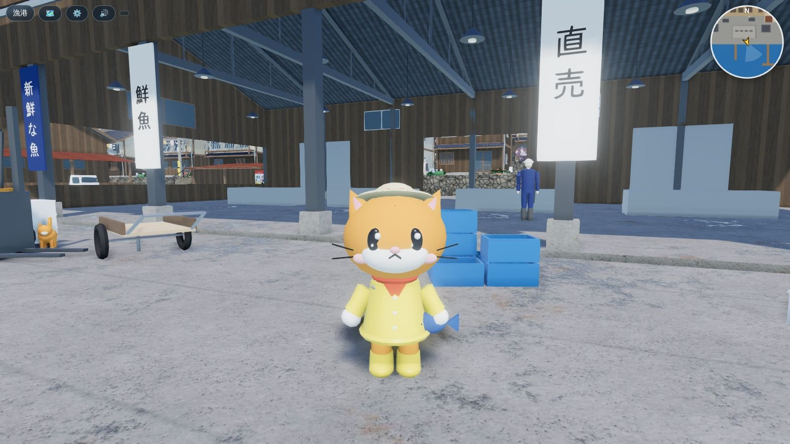

## 遊び方

| 操作 | スマホ | PC |
|---|---|---|
| 歩く | 画面の左側をドラッグ(その場にスティックが出ます) | WASD / 矢印キー |
| 走る | 右下の「ダッシュ」(押すたびに切り替え) | Shift |
| ジャンプ | 🕸️ボタンをタップ | Space(マウス操作中は左クリックも) |
| クモの糸スイング | 空中で🕸️ボタンを長押し(離すと勢いよく飛ぶ) | 空中で Space 長押し / 左クリック長押し |
| 壁登り・屋根の上 | 建物の壁に向かって進むと張り付いて登り、上で屋根に乗る。壁でジャンプすると離れる | 同じ |
| 見まわす | 画面の右側をドラッグ(上下で見上げる・見下ろす) | マウスでドラッグ、Q / E |
| カメラの距離 | 2本指でつまむ、右の ＋ / － | マウスホイール、+ / - |
| 地図 | 🗺️(地図から各地区へ移動もできます) | M / 🗺️ |
| 時間帯・画質 | ⚙️ で 昼 / 夕方 / 夜、軽量 / 標準 / 高画質 / 最高(PC) | T で時間帯を切り替え |

PC では画面をクリックするとマウスがゲームに固定され(ポインターロック)、マウスを動かすだけで見まわせます。Esc で解除します。

- 新しいエリアに入ると、画面の上にエリア名が出ます。右上は北が上のミニマップです。
- 位置・カメラの距離・時間帯・画質は5秒ごとと画面を閉じたときに端末内(localStorage)に保存され、次回は「つづきから」で再開できます。

## 町の構成

| 地区 | 内容 |
|---|---|
| 漁港 | 岸壁(黄黒の縁石・係船柱・防舷タイヤ・はしご)、3本の木の桟橋、揺れる漁船8隻と小舟、魚市場、第一水産の事務所、漁協の木造倉庫とトタン倉庫、漁具小屋、青いテント、魚箱・発泡スチロール箱・網・浮き・カゴ網、フォークリフト、軽トラ |
| 防波堤 | 西から南へ曲がる長い防波堤と先端の赤灯台(夜に点滅)、東の短い防波堤、外側に積まれたテトラポッド約200個 |
| 商店街 | 港から丘へ上る坂道(勾配約13%)。両側に鮮魚店・海鮮食堂・居酒屋・雑貨店・土産物屋・喫茶・酒屋など16軒(看板・のれん・提灯・日よけ・のぼり)、電柱と電線、街灯、自販機、自転車 |
| 丘の住宅街 | 高さ1.75mの石垣で区切られた7段の段々。各段に路地と40軒以上の住宅(6種類×色違い)、段と段をつなぐ手すり付きの石段14本、商店街から各段への路地 |
| 海凪神社 | 住宅街の上から鳥居と石灯籠の並ぶ長い石段、境内に鳥居・拝殿(賽銭箱・鈴・しめ縄)・狛犬・石灯籠・しめ縄の御神木・桜 |
| 崖の遊歩道と灯台の丘 | 神社から丸太の柵の遊歩道で丘へ。白い灯台(夜は光が回ります)、東屋の展望台、望遠鏡、案内板、港町を見下ろす白い柵 |
| 東の高台と浜 | 斜面の石垣の上の家々、砂浜と岩場 |

## 画面と表現

- **海**: 水面の手前に描かれた景色(海底・岩・岸壁・桟橋の杭)を画面からコピーして、波で屈折させて透かします。水深と視線の角度に応じた光の吸収(Beer–Lambert。赤から先に消える)で、浅瀬は透明なエメラルド、深いほど青。港の中は水深4〜6mの砂地に岩と海藻が見え、海底には揺れるコースティクス。港内は穏やか、外海はうねり。空の映り込み(フレネル)、太陽のきらめき、岩やテトラポッドに当たる白波。漁船は同じ波の式で揺れます(屈折は標準以上。軽量は半透明の合成)。
- **遠景**: 尾根と岩の海岸線・森のある島々と、水平線に3層の山並み。遠いものほど空気の色に霞みます(専用のかすみ表現)。
- **光**: 昼・夕方・夜を2.5秒かけて切り替え。太陽の向き・色、空のグラデーション、雲、夜の星、霧の色が変わり、環境の映り込み(PMREM)も作り直します。夜は提灯・街灯・石灯籠・自販機・窓の明かり・灯台が光ります。
- **影**: プレイヤーの周り(標準45m・高画質60m)に太陽の影。影の範囲はプレイヤーについていき、テクセルにそろえてちらつきを抑えています。
- **材質**: 木・漆喰・瓦・石垣・コンクリート・トタン・アスファルト・石畳などはタイル状のPBRテクスチャ(色+法線)。魚市場まわりの地面は水たまりの粗さマップで濡れて光ります。地形は傾きで草・土・岩、海辺は砂を混ぜるシェーダーです。
- **自然**: 木と植え込みは、葉の房を描いた透過テクスチャ(広葉・松葉・桜・低木)の板を樹冠のまわりに重ねた「葉カード」方式で、陰影は樹冠の中心から外向き。葉・草・網は風で揺れます(頂点シェーダー)。山の森(標準で木1800本)、崖に生える低木と岩、遠くの島々。カモメが港の上を飛び、町には漁師・お店の人・町の人・猫が歩いています。
- **音**: WebAudio で合成した波の音(海に近いほど大きい)、カモメの声、足音(石・土で違う)、夜の虫の声。

## PC 向け「最高(PC)」画質

PC のブラウザで開くと初期値が **最高(PC)** になります(`?q=ultra` でも指定可)。スマホ向けの設定に加えて:

- **ポストプロセス**: GTAO(地面と建物の接地面・軒下・路地の環境遮蔽)→ ブルーム(夜の街灯・提灯・窓、夕日のきらめき。時間帯で強さが変わる)→ トーンマッピング → SMAA(アンチエイリアス)。HDR の NaN と強すぎる光は事前に除いて、光のにじみが画面に広がらないようにしています。
- **テクスチャ 1024px**(`../uminagi-assets/textures/1k/`、同じ柄の2倍解像度、異方性フィルタ16倍)
- **影 4096px を半径90m**、街の灯りの点光源 12個
- **木 約2800本・草 9000株**、建物の詳細モデルを約165m先まで、木の詳細モデルを約100m先まで表示
- 描画解像度は画面の解像度(最大2倍)のまま

スクリーンショット(最高(PC)、ヘッドレス Chromium で描画):

| | |
|---|---|
| 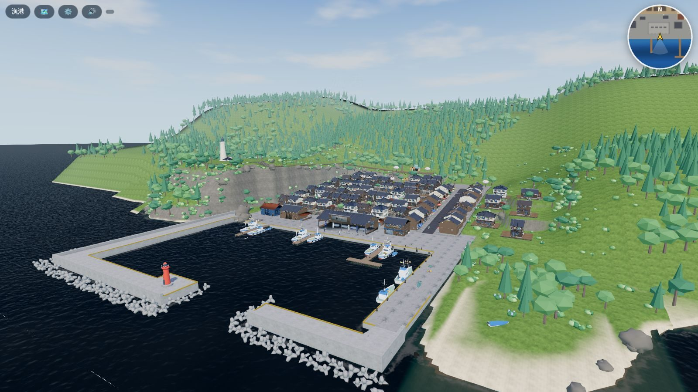 | 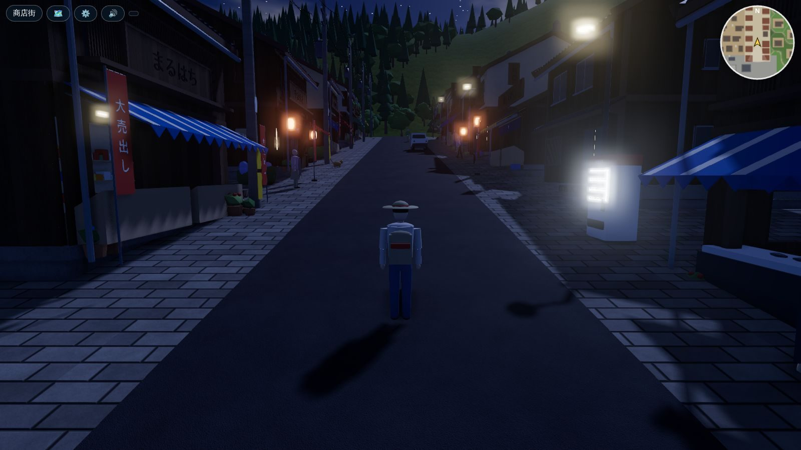 |
| 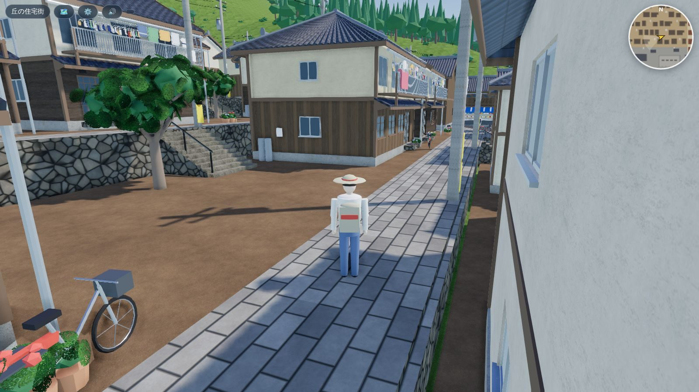 | 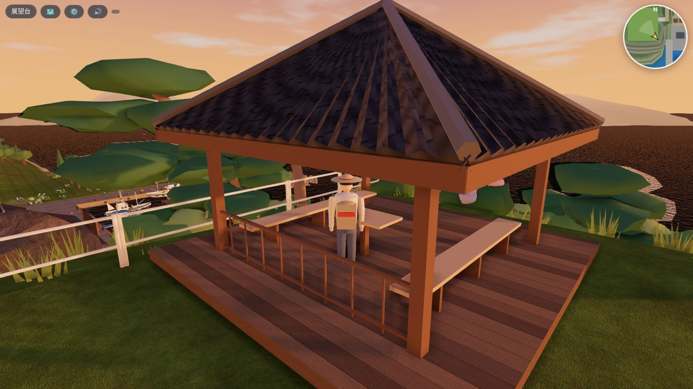 |
| 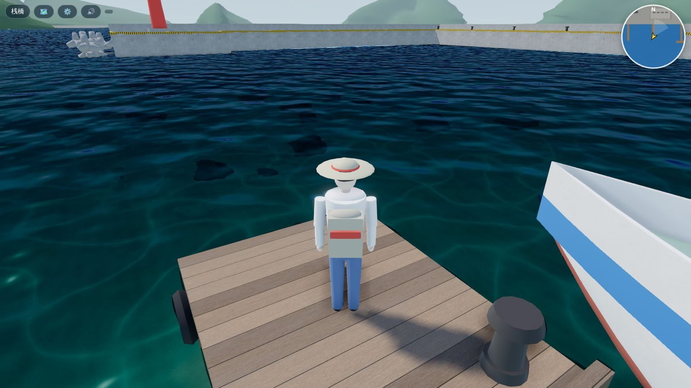 | 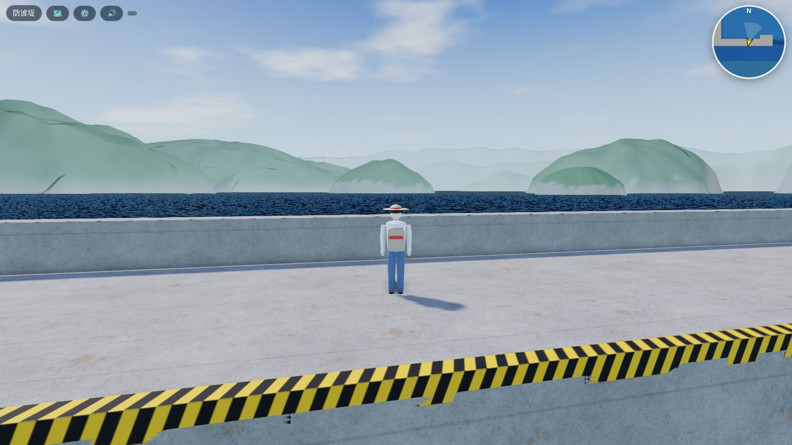 |
| 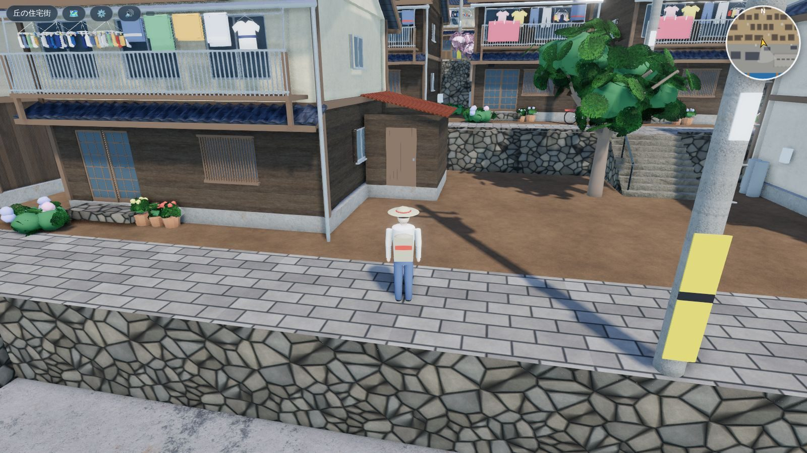 | |

## しくみ

```
uminagi/
  index.html, css/style.css      画面とHUD
  js/terrain.js   町の設計図: 港・商店街・7段の段々・石段・神社・崖の遊歩道・丘の「台」(高さ一定/坂/階段)の一覧、
                  0.5m 格子の高さ(歩ける高さ)、自然の地形(海岸線・山・崖)と町へのなじませ、
                  それらから作る石垣・岸壁・石段・手すり・縁石・地形のメッシュ、海の深さテクスチャ
  js/town.js      モデルの読み込みと配置、インスタンシング(GPU instancing)、LOD、当たり判定、人・船・カモメの動き、電線
  js/world.js     空(雲・星)、太陽と環境光、時間帯、海のシェーダー、遠くの島
  js/materials.js マテリアル名 → 共有の PBR マテリアル(テクスチャ・法線マップ)、風で揺れる葉、地形のブレンド
  js/player.js    歩く・走る・段差と階段・落下、建物や柵との当たり判定、壁にめり込まない三人称カメラ
  js/input.js     タッチ(左スティック・右スワイプ・ピンチ)とキーボード・マウス
  js/audio.js     環境音
  js/main.js      起動、画質、HUD(ミニマップ・地図・エリア名・設定)、セーブ、町の書き出し、経路の検証
  sw.js           オフライン用キャッシュ(tools/build_sw.py が生成)
  tools/          build_sw.py(sw.js 生成)、make_icons.py(アイコンを Blender で描画)、export_scene.mjs(町の書き出し)
  tests/e2e.mjs   iPhone 13 横向きを再現した自動テスト
  vendor/         three.js r169 と使うアドオン(GLTFLoader・meshopt デコーダなど)
```

### 歩ける場所のルール(`player.js`)

- 地面の高さは「台」(岸壁・道・段々・階段・桟橋…)があればその式、なければ自然の地形。0.6m を超える段差は登れず(石垣・岸壁は壁になる)、階段と坂はそのまま上り下りできます。
- 自然の斜面は傾きが約46°を超えると登れません。台から台へは飛び降りられますが、崖や海へは降りられません(海に落ちない)。
- 建物・船・木・電柱・柵・小物は回転した箱か円の当たり判定で、壁に沿って滑ります。人とは押し合います。
- カメラはプレイヤーと自分の間に建物や地面があると近づきます。

### 描画の工夫(iPhone 向け)

- 同じモデルはすべて **GPU インスタンシング**。テクスチャの無い色だけのマテリアルは1つにまとめ(色・粗さ・金属度・発光は頂点属性)、同じテクスチャの部品も1つにまとめているので、家1種類あたりの描画は約8回です。
- **LOD**: 建物は近くで詳細(LOD0)、遠くで約30%に減らしてテクスチャも省いた LOD1。木は3段階(詳細 → 減らした形 → 約30三角形の代用形)。小物は遠くで消えます。LOD は1つずつの距離で切り替え、まとめて切り替えられるときは一括で行います。
- **視錐台カリング**: 小物は200m、自然物は128m の区画ごとにインスタンスをまとめ、区画ごとに画面外を省きます。
- **影**は近くの詳細なモデルだけが落とします(影の範囲 45〜60m に合わせる)。
- モデルは meshopt 圧縮+量子化(約9MB → 読み込み時に展開)。テクスチャは512pxのJPEGをミップマップ付きで使います。
- 画質は「軽量 / 標準 / 高画質」(解像度・影・木と草の数・LOD 距離)。スマホは標準、PCは高画質が初期値です(URL に `?q=low` などでも指定可)。

## テスト

```
python3 -m http.server 8123          # リポジトリ直下で
node uminagi/tests/e2e.mjs http://localhost:8123/uminagi/ [スクリーンショットの保存先]
```

<!-- RESULTS -->
### 確認した結果(2026-10-18、ヘッドレス Chromium + SwiftShader、iPhone 13 横向き 844×390 を再現)

`tests/e2e.mjs` の37項目すべて合格:

- 読み込み(約4.5秒)、タイトル → HUD、町の構築(モデル83種・当たり判定892個・漁船8隻・人と猫18)
- 仮想スティックで前進(1.5秒で5.0m)、ダッシュ(1秒で6.8m)、右側スワイプでカメラ回転
- 魚市場の奥の壁・住宅の正面の壁で止まる、岸壁の端で海に落ちない
- 石段で段々を上がる(1.60m → 3.35m)、商店街の坂を上る
- **歩いて行けるかの検証**: 港から、プレイヤーと同じ移動ルール(段差・傾き・当たり判定)で1m格子を塗りつぶし(約5万マス)、魚市場・桟橋・赤灯台・東の防波堤・東の岸壁・坂の上の広場・住宅の1段目/4段目/7段目・神社・崖の遊歩道・灯台の丘・展望台・東の高台の家・浜の15か所すべてに到達できることを確認
- エリア名表示、地図と地図からの移動、夕方・夜の切り替え(夜は提灯・窓が光る)、セーブ → 再読み込み →「つづきから」で位置と時間帯が戻る、コンソールエラーなし

描画負荷の目安(港の眺め): 軽量 約350回の描画・45万三角形、標準 約450回・68万三角形(影を含む)。

**まだ確認していないこと**: 実機の iPhone(Safari)でのフレームレート・発熱・タッチの操作感は未確認です。上の数字は CPU で描画するエミュレータでの値で、実機の速さは分かりません。重い場合は ⚙️ の「軽量」を選んでください。テクスチャは JPEG のままで、KTX2 などの GPU 圧縮テクスチャにはしていません(この環境に変換ツールが無いため)。建物の中には入れません(戸は閉まっています)。

### スクリーンショット

| | |
|---|---|
| 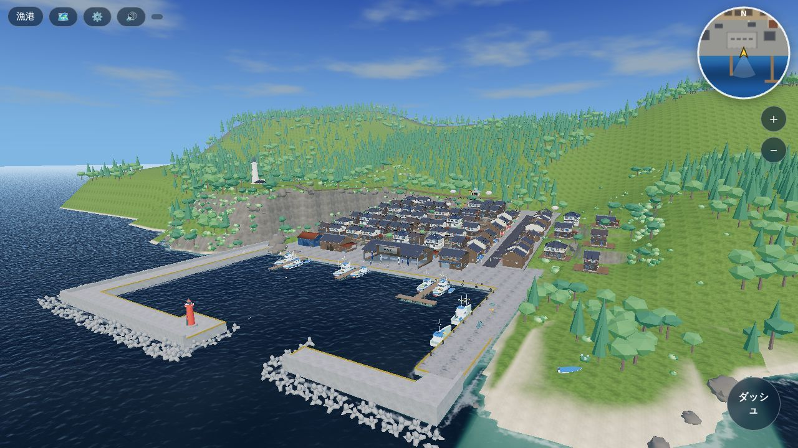 | 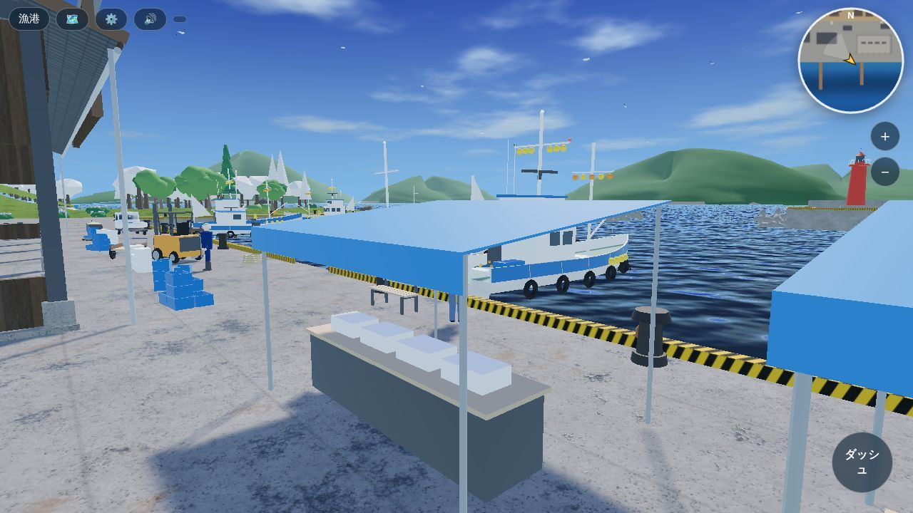 |
| 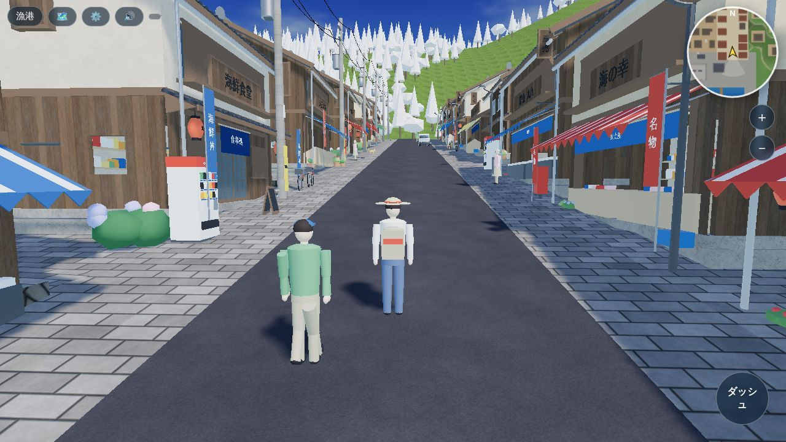 | 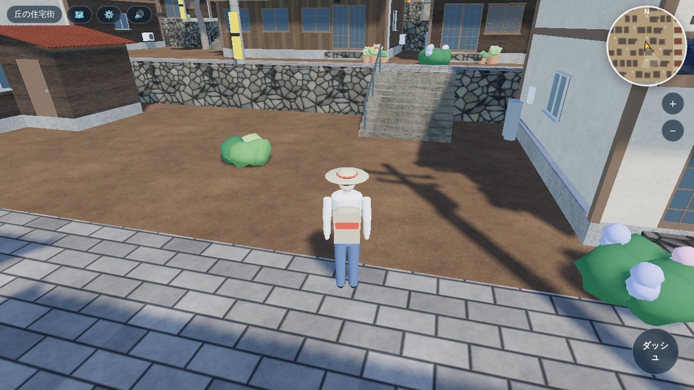 |
| 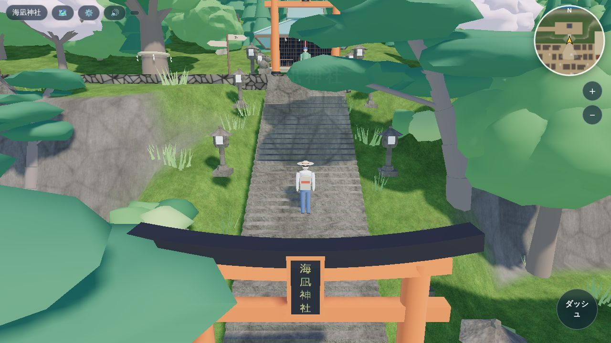 | 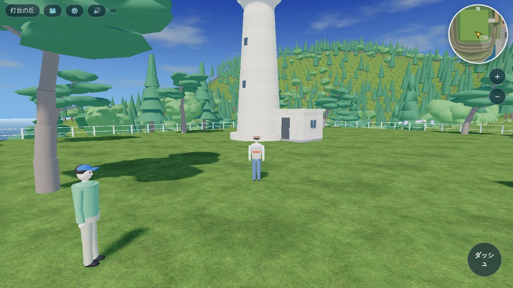 |
| 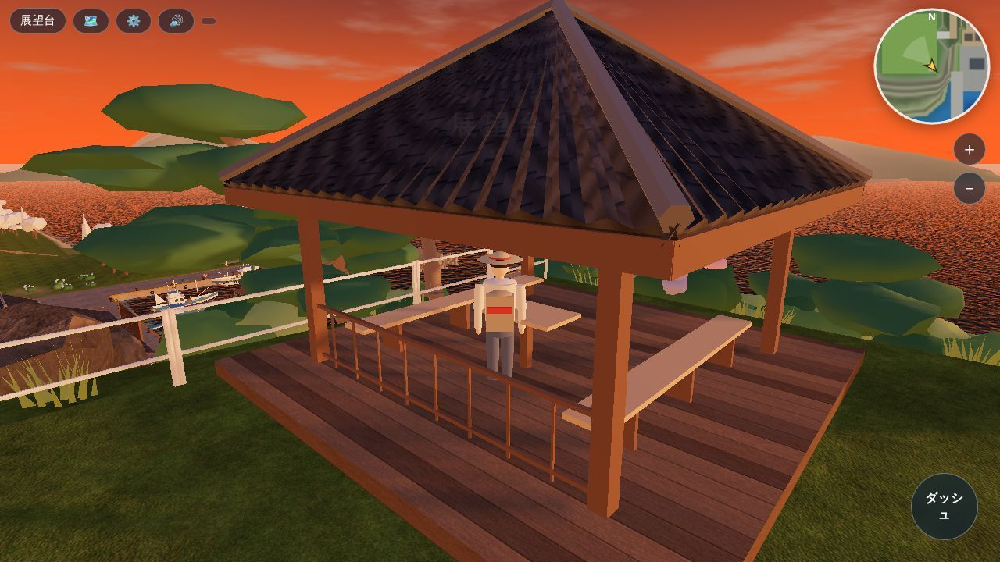 | 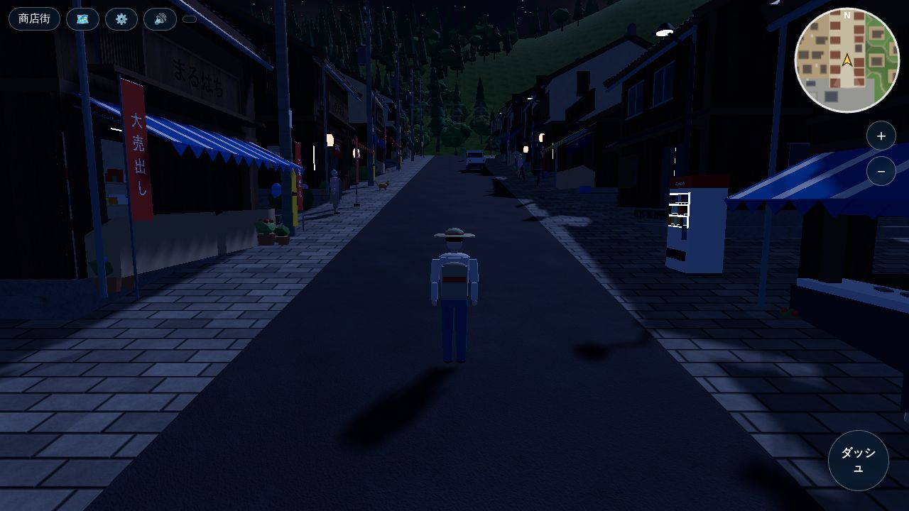 |
<!-- /RESULTS -->
